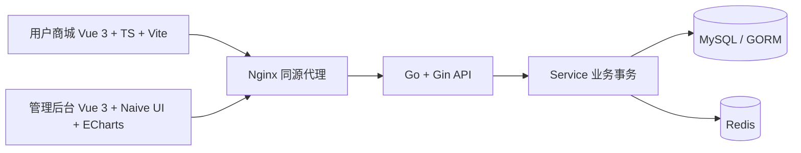

# 架构与业务约束

系统由两个独立 Vue 3 SPA 和一个 Go REST API 组成。前台和后台均由同源 Web 服务器代理 `/api/v1`，不向浏览器传递数据库、Redis 或签名密钥。所有金额使用人民币分的整数；数据库时间、统计口径使用 UTC。



## 分层

`router` 注册路由；`middleware` 负责认证、角色、请求限流、访问记录和安全头；`controller` 校验 DTO、权限边界与响应；`service` 负责购物车、事务订单、认证、缓存及售后；`model` 定义实体、外键和索引；`database` 管理连接池和自动迁移；`config` 从环境读取配置。`shared` 放前后台共用的响应类型、金额与图片处理、API 客户端。

前端按路由延迟加载，商品图片使用本地 SVG 演示资产或 HTTPS 图片地址。后台图表只加载所需 ECharts 模块，卸载时释放实例，尺寸变化自动适配。生产使用 Vite 压缩产物和静态资源缓存。

## 交易边界

订单创建即预占库存；系统没有接入支付网关。管理员核实线下付款后将 `pending` 改为 `confirmed`。用户只能取消待确认订单、确认已发货订单的收货。管理员可确认、取消待确认/已确认订单、发货、完成。发货必须填写物流公司和运单号。

```
pending -> confirmed -> shipped -> completed
pending / confirmed -> cancelled
shipped / completed -> refunded  (售后批准)
```

取消和售后批准在事务内恢复库存，重复操作被拒绝。售后为整单退货申请，管理员应确认实际退货和线下退款后批准；系统记录处理结果，不会调用支付退款。待确认订单没有自动超时取消任务，运营应处理积压订单。

订单总额由后端当前 SKU 价格计算，订单明细保存商品名、规格、价格快照。`Idempotency-Key` 对同一用户唯一，同一 key 重试返回同一订单。用户不能读取/修改其他人的购物车、订单、评价或售后。评价限自己的已完成订单明细，每条明细只能评价一次。

## 并发与缓存一致性

同一用户的购物车写入和结算先锁 users 行，再操作购物车/SKU。结算按 variant_id 顺序锁定 SKU，在 MySQL 事务内检查库存、扣减、生成订单并清空购物车。多用户争抢库存不能超卖。

商品上下架有单独 PATCH API，只修改可见性。编辑已有 SKU 必须传入打开表单时的 `expected_stock`。库存未修改时仅保存商品资料/价格；显式调整库存时必须与当前库存相符，否则返回 409，避免旧表单覆盖销售扣减。

Redis 实际用途：

| 键                         | 内容与过期                | 一致性规则                                                                        |
| -------------------------- | ------------------------- | --------------------------------------------------------------------------------- |
| `session:{jti}`            | 用户 ID，24 小时          | JWT 和 Redis 会话同时有效；退出删除会话，每次认证重读账号状态/角色                |
| `product:{id}:v{revision}` | 热点商品详情，5 分钟      | MySQL 先检查上架状态及版本；资料变更递增版本；SKU 库存/价格和分类实时读取         |
| `cart:{uid}:v{revision}`   | 购物车成员及数量，10 分钟 | 写入事务递增 users.cart_version；读取从 MySQL 获取当前版本；SKU 价格/库存实时读取 |
| `visits:{UTC日}:{IP摘要}`  | 访问计数，7 天            | 原子 Lua INCR + 初次 EXPIRE；不存原始 IP                                          |
| `rate:auth:{IP摘要}`       | 登录/注册计数，60 秒      | 原子计数；30 次/分钟；超限 429                                                    |

使用数据库提交版本选择缓存键，旧请求即使在删除缓存后回填旧数据，也只能写入旧版本键。失效删除失败有日志，正确性不依赖 DEL 成功；旧版本键由 TTL 回收。Redis 详情缓存异常时回退数据库；认证和限流在 Redis 故障时拒绝请求，防止绕过。

## 权限与部署

`user` 使用个人接口；`staff` 可管理商品/分类/订单/售后和查看统计；`admin` 额外管理用户和角色。用户资料 DTO 不接收 role/enabled/password。管理员不能禁用或降级自己的账号。

密码使用 bcrypt；JWT 限定 HS256、issuer、过期；令牌放浏览器 sessionStorage。需要公网 HTTPS、可靠备份和服务器访问控制。默认不信任转发 IP；只有 `TRUSTED_PROXIES` 指定的代理网络可提供 X-Forwarded-For。Compose 使用专用 172.30.88.0/24 网络，Nginx 覆盖客户端传来的该头。若接入外层反向代理，须按实际信任链修改 Nginx real_ip 配置，不应信任任意来源的转发头。

GORM AutoMigrate 用于首次建表和当前版本的增量结构同步；涉及破坏性修改时应单独编写、审查数据库迁移并先备份。API 文档见 [api.md](api.md)，部署与运行见 [../README.md](../README.md)。

本机应用使用 Redis DB0，后端集成测试固定使用 DB15。多个环境应使用独立 Redis 实例或不同 REDIS_DB，防止编号相同的会话与缓存互相污染。
