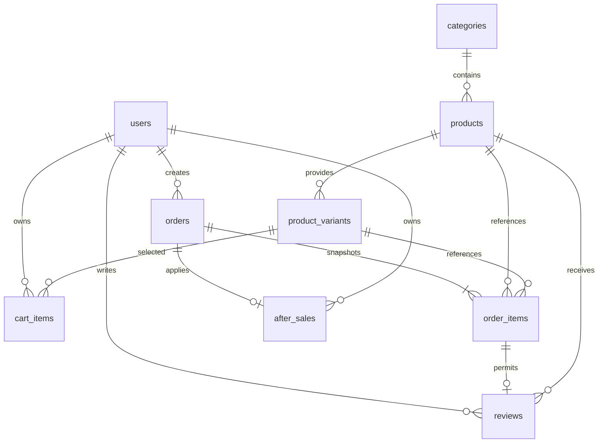

# MySQL 数据模型

`server/model/models.go` 是模型定义来源；`server/database/init.sql` 是从实际迁移后的 MySQL 8.4 导出的空库初始化结构，已在独立数据库中导入验证。字符集 utf8mb4，外键限制删除，时间精度毫秒；金额为 bigint 分、主键 unsigned bigint。

| 表               | 核心字段与索引                                                                                                 | 关系                                      |
| ---------------- | -------------------------------------------------------------------------------------------------------------- | ----------------------------------------- |
| users            | email 唯一；bcrypt password；name/avatar/phone；role 索引；enabled；cart_version                               | 1:N orders/cart_items/reviews/after_sales |
| categories       | name 唯一                                                                                                      | 1:N products                              |
| products         | category_id 索引；name 索引；description/images；active 索引；cache_version                                    | 属于分类；1:N product_variants            |
| product_variants | SKU 唯一；product_id 索引；specification；price>0；stock>=0                                                    | 属于商品，被购物车和订单引用              |
| cart_items       | (user_id,variant_id) 联合唯一；quantity>0                                                                      | 用户与规格                                |
| orders           | number 唯一；(user_id,idempotency_key) 联合唯一；status 索引；total；recipient/phone/address；carrier/tracking | 用户；1:N order_items；1:1 after_sales    |
| order_items      | order_id/product_id/variant_id 索引；名称/规格/单价/数量快照                                                   | 订单、商品、SKU；1:1 reviews              |
| reviews          | order_item_id 唯一；user_id/product_id 索引；rating 1–5；content                                               | 用户、商品和已完成订单明细                |
| after_sales      | order_id 唯一；user_id/status 索引；reason/status/note                                                         | 整单售后，用户/订单                       |

每个实体都包含 id、created_at、updated_at。前台接口隐藏密码、内部版本和幂等 key。已有交易/购物车引用的商品不能删除，应下架；订单/评价保留历史。商品规格更新保留既有 SKU，防止破坏历史关系。

库存与订单的更新放在同一 InnoDB 事务内。库存操作采用行锁和条件扣减，购物车使用用户行锁和提交版本。详情缓存不是库存事实来源，checkout 不依赖 Redis 数值。
